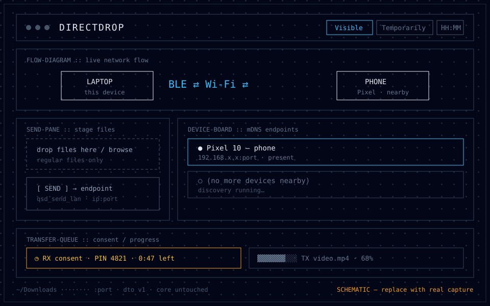
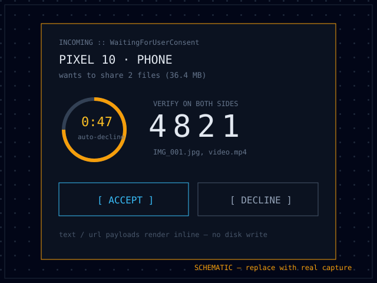

<div align="center">
  
  <a href="README.md"></a>
  <a href="README.it.md"></a>
  <a href="README.es.md"></a>
  <a href="README.fr.md"></a>
  <a href="README.de.md"></a>
  <a href="README.ru.md"></a>
  <a href="README.zh.md"></a>
  <a href="README.ja.md"></a>
</div>

<div align="center">
  
  <h1>DirectDrop</h1>
  <p><strong>Quick Share (Nearby Share) para Linux que não exige que os dois dispositivos estejam no mesmo Wi-Fi — agora com uma GUI para desktop.</strong></p>

  <a href="https://github.com/DeveloperMatt02/DirectDrop/releases/latest"></a>
  <a href="https://github.com/DeveloperMatt02/DirectDrop/stargazers"></a>
  <a href="https://github.com/DeveloperMatt02/DirectDrop/releases/latest"></a>
  
  
  
  
  <a href="https://github.com/DeveloperMatt02/DirectDrop/actions/workflows/release.yml"></a>

  <br />
  <a href="https://github.com/DeveloperMatt02/DirectDrop/stargazers"></a>

  <br /><br />
  <a href="https://github.com/DeveloperMatt02/DirectDrop/releases/latest"></a>
  <a href="#instalação-rápida-terminal"></a>
  <a href="#capturas-de-tela"></a>
  <a href="https://github.com/DeveloperMatt02/DirectDrop/issues/new"></a>
  <a href="https://github.com/DeveloperMatt02/DirectDrop/stargazers"></a>
</div>

> Um fork do `quickshare-direct` original. A pilha headless de recebimento/envio foi preservada sem alterações (primeiro contato via anúncio BLE/GATT, upgrade para Wi-Fi Direct GO/cliente, fallback para LAN, helpers polkit, daemon CLI headless). O que este fork adiciona é uma GUI de desktop Tauri redesenhada em `app/main/` com paridade total de comportamento com o CLI.

## Instalação rápida (Terminal)

Comando único universal — detecta a distribuição e instala o pacote correspondente da
versão mais recente do `DeveloperMatt02/DirectDrop` (`.rpm` no Fedora/RHEL, `.deb` no
Debian/Ubuntu, `.AppImage` em `~/.local/bin` em todos os outros casos):

```bash
curl -fsSL https://raw.githubusercontent.com/DeveloperMatt02/DirectDrop/main/get-directdrop.sh | bash
```

Comandos diretos por distribuição (mesma origem, sem script auxiliar):

```bash
# Fedora / RHEL (.rpm)
URL=$(curl -fsSL https://api.github.com/repos/DeveloperMatt02/DirectDrop/releases/latest \
  | grep -o 'https://[^"]*\.rpm' | head -n 1)
sudo dnf install -y "$URL"

# Debian / Ubuntu (.deb)
URL=$(curl -fsSL https://api.github.com/repos/DeveloperMatt02/DirectDrop/releases/latest \
  | grep -o 'https://[^"]*\.deb' | head -n 1)
curl -fL -o /tmp/directdrop.deb "$URL"
sudo apt-get install -y /tmp/directdrop.deb
```

Ou escolha o artefato manualmente na [versão mais recente](https://github.com/DeveloperMatt02/DirectDrop/releases/latest).

## 🖥️ Capturas de tela

Janela principal (console em modo de operação: cabeçalho de estado, fluxo ao vivo laptop ⇄ celular, painel de envio, quadro de dispositivos, fila de transferências):



Transferência recebida — cartão de verificação de PIN UKEY2 com contagem regressiva de 60s e recusa automática:



> [!NOTE]
> São espaços reservados esquemáticos no estilo blueprint do aplicativo. Substitua `docs/screenshots/gui-main.svg` e `docs/screenshots/gui-consent.svg` por capturas reais (`pnpm tauri dev`, capture a janela com captura de tela, salve como `.png` ao lado delas e atualize os links acima).

O guia rápido original continua válido:

1. **Descoberta + primeiro contato via Bluetooth LE** (funciona com o celular fora do Wi-Fi).
2. **Handshake criptografado** (UKEY2, PIN exibido nos dois lados) por esse link Bluetooth.
3. **Upgrade para velocidade Wi-Fi**: o laptop cria um **grupo Wi-Fi Direct** ao lado da sua conexão Wi-Fi normal (que continua funcionando) e entrega as credenciais ao celular; ou, se o celular estiver no mesmo Wi-Fi, a transferência passa para a rede local. Um hotspot simples é o fallback.
4. **Notificações no desktop**: Aceitar/Recusar (com o PIN) e depois "Abrir pasta".

| | Estado |
|---|---|
| Receber do Android (testado no upstream: Pixel 10, Android 16) | funciona |
| Celular fora do Wi-Fi → Wi-Fi Direct (75 MB, ~5 MB/s) | funciona |
| Celular no mesmo Wi-Fi → LAN | funciona |
| Primeiro contato via Bluetooth Classic | experimental (`QSD_BT_CLASSIC=1`) |
| Enviar para Android → Wi-Fi Direct do celular (300 MB, ~36 MB/s) | funciona (`quickshare-direct send`, gerenciador de arquivos, painel de envio da GUI) |
| Pacotes: Debian/Ubuntu, Fedora, Arch, genérico (x86_64, aarch64) | instalação em uma linha, veja abaixo |

---

## O que este fork introduz: GUI de desktop reativada e redesenhada (`app/main/`)

O repositório original mantém o antigo app Tauri do rQuickShare em `app/`, mas não o compila, distribui nem testa (seu caminho de envio é apenas LAN/mDNS, sem o caminho Bluetooth / Wi-Fi Direct). Este fork reativa essa ideia como uma GUI nova e dedicada em `app/main/`, que usa o **mesmo** motor `core_lib` (`rqs_lib`) do CLI — sem implementação paralela do protocolo.

### Stack e visual

- **Tauri 2.2, Vue 3.5, Pinia 2.x, Tailwind CSS 3.4.** A entrada do frontend é `app/main/src/App.vue`; o estado fica nos stores Pinia (`src/stores/session.ts`, `devices.ts`, `transfers.ts`).
- **Estética técnica de blueprint:** console escuro em modo de operação, métricas tabulares em monospace, diagrama ao vivo do fluxo de rede entre o laptop e o celular (`FlowDiagram.vue` / `FlowHero.vue`), linhas finas de 1px, sem excesso de marketing. Layout: `StatusHeader` → `FlowDiagram` → `SendPane` + `DeviceBoard` → `TransferQueue`, com um rodapé fino de detalhes do receptor (caminho de download, porta).

### Bridge Rust em processo não invasiva

A GUI executa o `rqs_lib` em processo. A fronteira é exatamente dois arquivos novos mais um contrato versionado — **zero alterações no motor central do protocolo**:

- `app/main/src-tauri/src/dto.rs` — o único formato de transmissão. Os tipos de domínio centrais em `core_lib` deliberadamente não derivam `Serialize`/`Deserialize`; cada payload de `invoke`/`emit` do Tauri passa por esses DTOs serde com mapeamentos `From` explícitos. `DTO_VERSION = 1`, garantido pelo teste Rust `dto_version_matches_ts` contra o espelho TypeScript.
- `app/main/src-tauri/src/bridge.rs` — assina os canais `broadcast`/`watch` do núcleo (`message_sender`, `dch_sender`, `visibility_sender`, `ble_receiver`) e reemite eventos Tauri com throttling/deduplicação. Eventos de progresso têm throttling (emite em mudança de estado, ou com delta ≥256 KiB, ou ≥500 ms; estados terminais sempre emitidos). Estouros `Lagged` do broadcast são ignorados com log de debug, nunca com falha — mesma política do CLI.
- `app/main/src/types/qsd.ts` — espelho TypeScript estrito de `dto.rs` (nomes de eventos, `VisibilityDto`, `TransferStateDto` com todos os 18 estados centrais, `PayloadKindDto`, `TransferDto`, `EndpointDto`, `SendPayloadDto`, `ConsentDto`, `SnapshotDto`, códigos de erro). Inclui os auxiliares `humanSize` / `describeTransfer` (port do `describe()` do CLI), `baseName` e `validateSendFiles`, além dos conjuntos `TERMINAL_STATES` / `ACTIVE_PROGRESS_STATES` / `HANDSHAKE_STATES`.

Comandos Tauri expostos (`src-tauri/src/cmds/`, ligados em `main.rs`): `qsd_snapshot`, `qsd_set_visibility`, `qsd_set_download_path`, `qsd_set_device_name`, `qsd_start_discovery`, `qsd_stop_discovery`, `qsd_consent`, `qsd_send_lan`, `qsd_get_hostname` (mais os shims legados `get_hostname` / `change_download_path`). Eventos do backend → frontend: `qsd://transfer`, `qsd://endpoints`, `qsd://visibility`, `qsd://ble-presence`.

### Paridade total de comportamento com o CLI

- **Cartão instantâneo de verificação de PIN UKEY2** (`ConsentCard.vue`): nome do remetente, tipo de dispositivo, PIN, resumo do conteúdo e lista de arquivos aparecem assim que o núcleo atinge `WaitingForUserConsent`. Um anel de **contagem regressiva de 60 segundos** (`QSD_CONSENT_TIMEOUT_MS`, respeitando a substituição via env `QSD_CONSENT_TIMEOUT` lida em `dto.rs`) expira o cartão; a expiração dispara a mesma **recusa automática** (`ConsentDecline` no canal) que o CLI executa. Aceitar/Recusar/Cancelar mapeiam 1:1 para `TransferAction`s do núcleo via `ConsentDto::into_channel_message`.
- **Seletor de visibilidade de 3 estados** (`StatusHeader.vue` → `qsd_set_visibility`): `Visible`, `Temporarily` (60 s, com ponto pulsante âmbar e exibição do tempo restante), `Hidden` (`Invisible`). O temporizador Temporarily→Invisible fica no `mdns.rs` do núcleo; a GUI apenas reflete o evento `qsd://visibility` e o persiste via store do Tauri. Sem reimplementação de temporizador no lado da GUI.
- **Faixa passiva de alerta de presença BLE:** avistamentos do listener BLE do núcleo chegam como eventos `qsd://ble-presence` com throttling (120 s). Quando oculta (`Invisible`), a bridge ainda dispara uma notificação de sistema sugerindo uma janela temporária de visibilidade; o frontend mostra um toast informativo ("Há um celular por perto compartilhando — verifique a visibilidade"). Respeita a semântica central de `QSD_BLE_SCAN` / `QSD_NO_BLE_SCAN`.
- **Tratamento de transferências de texto/URL embutidas sem gravações forçadas em disco** (`TransferCard.vue`): conteúdos `Text`, `Url` e `WiFi` são renderizados embutidos com pré-visualização mais cópia para a área de transferência (plugin clipboard-manager do Tauri); nenhum arquivo é gravado no disco para exibi-los. Conteúdos de arquivo mostram contagem de arquivos RX, nomes e progresso preciso em bytes (`ack_bytes` / `total_bytes`).
- **Envio de arquivos via LAN/mDNS de saída com validação de arquivo regular** (`SendPane.vue` + `qsd_send_lan`): selecione arquivos via diálogo ou arrastar-e-soltar, escolha um endpoint mDNS descoberto (`EndpointDto`, `addr = ip:port`) e envie pelo canal `sender_file` do núcleo como `SendInfo { ob: Files }`. A validação é igual à do CLI: seleções vazias e diretórios são rejeitados com erros `VALIDATION` (`{f}: not a regular file (folders aren't supported)`); o frontend falha rápido nos casos óbvios antes de chamar o backend.

### Executando a GUI a partir do código-fonte

```bash
cd app/main
pnpm install
pnpm tauri dev     # live GUI against local core_lib (path dep: ../../core_lib)
pnpm ts-check       # vue-tsc --noEmit contract check
pnpm test           # vitest suite (tests/)
pnpm build          # production Tauri bundle
```

Lado Rust: `cd app/main/src-tauri && cargo check` / `cargo test` (inclui os testes de formato de transmissão do DTO). Os pré-requisitos de sistema são os mesmos do daemon (BlueZ, NetworkManager, cabeçalhos libdbus, protoc, cargo ≥ 1.85) mais Node/pnpm e dependências Linux do Tauri 2.x.

---

## Arquitetura e genealogia / Créditos

Visão em camadas deste fork:

```
Android phone ──BLE adv / GATT──▶ core_lib (rqs_lib) ◀──Tauri bridge──▶ Vue GUI
                                        │  (unchanged engine)
                                        ▼
                               Wi-Fi Direct GO / client,
                               LAN, hotspot fallback,
                               polkit Wi-Fi helpers
```

- **Autor(es) do `quickshare-direct` original:** o transporte fora da rede do qual este fork depende — monitoramento de anúncios BLE e servidor GATT para descoberta/primeiro contato, upgrade para grupo Wi-Fi Direct como dono do grupo / cliente ao lado da conexão Wi-Fi normal (com tratamento de fallback de canal único), os helpers raiz sob demanda `quickshare-ap@USER` / `quickshare-join@USER` com sua regra polkit, e o daemon CLI headless `quickshare-direct` com notificações no desktop. Todo o crédito pela engenharia de protocolo, Bluetooth e Wi-Fi pertence a eles; este fork não modifica nada disso.
- **`rQuickShare` por Martichou (e colaboradores como nozwock e martinalderson):** a implementação Rust/Tauri fundamental do protocolo Nearby Share / Quick Share no Linux sobre a qual tanto o original quanto este fork se baseiam — incluindo o núcleo `rqs_lib`, a estrutura original do app Tauri e o trabalho de descoberta Bluetooth levado para o `core_lib`.
- **Google Nearby (Apache-2.0):** a especificação do protocolo e as definições protobuf que definem o handshake UKEY2, a conexão, a introdução e os frames de conteúdo. A licença deste repositório continua GPL-3.0, como o rQuickShare.

---

### Instalação (daemon + pacotes CLI)

Debian 12+ / Ubuntu 22.04+ (e Mint, Pop!_OS, ...), Fedora, Arch (e Manjaro, EndeavourOS, ...),
outros via build genérico; x86_64 e aarch64:

```
curl -fsSL https://raw.githubusercontent.com/papshmeare/quickshare-direct/main/install.sh | sh
```

Ele instala a [versão](https://github.com/papshmeare/quickshare-direct/releases) mais recente com
o seu gerenciador de pacotes (`.deb`, `.rpm`, `.pkg.tar.zst`; as dependências vêm da sua distribuição),
abre as portas do Quick Share se o firewalld ou o ufw estiver ativo e inicia o receptor. Execute a mesma
linha de novo para atualizar; `curl -fsSL .../install.sh | sh -s -- --uninstall` remove. Prefere
ver o que acontece primeiro? Baixe o `install.sh` e leia, ou instale o pacote da
página de versões manualmente (`sudo apt install ./quickshare-direct_amd64.deb`,
`sudo dnf install ./quickshare-direct.x86_64.rpm`,
`sudo pacman -U quickshare-direct-x86_64.pkg.tar.zst`).

O que é instalado:
- `quickshare-direct`: o receptor (um serviço de usuário em cada sessão gráfica, com
  notificações) e os comandos `send` / `devices`;
- dois pequenos helpers raiz, iniciados sob demanda via systemd (`quickshare-ap@USER` cria o
  link Wi-Fi direto ao receber, `quickshare-join@USER` entra no do celular ao enviar), e uma
  regra polkit (`packaging/linux/polkit/50-quickshare-direct.rules`) que permite a um usuário local ativo
  iniciar/parar apenas as próprias instâncias (`start`/`stop`/`restart` em
  `quickshare-ap@USER.service` / `quickshare-join@USER.service`);
- um drop-in do NetworkManager que deixa as interfaces temporárias do link em paz, uma unidade que mantém
  o Bluetooth conectável, definições de serviço firewalld/ufw e entradas no gerenciador de arquivos.

Requisitos: systemd, BlueZ, NetworkManager com wpa_supplicant (o padrão nessas distribuições;
não iwd) e uma placa Wi-Fi capaz de rodar uma segunda interface ao lado da conexão normal (a maioria das placas
Intel/MediaTek/Qualcomm). As notificações precisam de um daemon que mostre botões de ação (GNOME,
KDE, swaync, mako, ...). O polkit mais antigo do Ubuntu 22.04 não permite que usuários iniciem os helpers, então lá
só funcionam Bluetooth e transferências na mesma rede. Defina seu domínio regulatório de Wi-Fi
(`sudo iw reg set XX`): com o domínio mundial padrão, o Linux não inicia um dono de grupo em 5 GHz.
Configurações: `~/.config/quickshare-direct/env` (`QSD_NAME=...`, `QSD_DIR=...`) para o receptor,
`/etc/default/quickshare-direct` para os helpers. Muitos chips Wi-Fi não conseguem hospedar o link direto em um
segundo canal ao lado da sua conexão normal, o que importa quando o seu roteador usa um canal que um
laptop pode não conseguir hospedar (canais de radar/DFS como o 100): então o laptop sai da sua rede Wi-Fi
pelos poucos segundos da transferência e reconecta depois (`QS_SINGLE_CHANNEL=auto`; `always`
para velocidade máxima também ao enviar, `never` para manter a conexão e usar Bluetooth como fallback).

A partir do código-fonte: `make && sudo make install` (precisa de cargo ≥ 1.85, protoc, cabeçalhos libdbus), depois
`systemctl --user enable --now quickshare-direct`.

### NixOS

```nix
# flake.nix inputs
quickshare-direct = { url = "github:papshmeare/quickshare-direct"; inputs.nixpkgs.follows = "nixpkgs"; };

# a module
{ inputs, ... }: {
  imports = [ inputs.quickshare-direct.nixosModules.default ];
  services.quickshare-direct = {
    enable = true;
    user = "alice";               # whose desktop session runs it
    wifiInterface = "wlp2s0";     # ip -br link
  };
}
```

Isso configura o receptor (serviço de usuário na sessão gráfica), o helper raiz que cria
o link Wi-Fi direto sob demanda (`quickshare-ap.service`, iniciável por esse usuário via polkit),
o helper que entra no grupo Wi-Fi Direct do celular ao enviar (`quickshare-join.service`),
portas do firewall, "conectável" no Bluetooth e mantém o NetworkManager fora das interfaces do link.
Defina seu domínio regulatório de Wi-Fi (`iw reg set XX`): com o domínio mundial padrão, o Linux não
inicia um ponto de acesso / dono de grupo em 5 GHz.

### Envio (CLI)

No celular, abra o Quick Share e toque em **Receber** (ou deixe visível para todos), depois:

```
quickshare-direct send photo.jpg notes.pdf      # to the one phone in receive mode nearby
quickshare-direct send --to Pixel video.mp4     # pick by name when several are around
quickshare-direct devices                       # list phones in receive mode
```

Ele encontra o celular via Bluetooth, mostra o PIN e, quando você aceitar no celular, os arquivos vão
pelo grupo Wi-Fi Direct do celular (com entrada em uma segunda interface, seu Wi-Fi continua conectado).
No gerenciador de arquivos: **Enviar para → Celular (Quick Share)** no Thunar (qualquer arquivo), ou Abrir com →
"Send with Quick Share" (tipos de arquivo comuns); ele informa via notificações. A
`SendPane` da GUI faz o mesmo envio LAN/mDNS via `qsd_send_lan` com PIN idêntico e
semântica idêntica de arquivo regular.

### Variáveis de ambiente (receptor, remetente, helpers)

O comportamento central é configurado via ambiente (veja `core_lib/src/bin/quickshare-direct.rs`,
`core_lib/src/hdl/*.rs`):

| Variable | Default | Effect |
|---|---|---|
| `QSD_DIR` | XDG Downloads, else `~/Downloads` | pasta de download |
| `QSD_NAME` | hostname | nome do dispositivo mostrado no celular |
| `QSD_PORT` | random | porta TCP para transferências recebidas |
| `QSD_BWU_PORT` | random | porta TCP para o listener de upgrade de Wi-Fi |
| `QSD_CONSENT_TIMEOUT` | `60` (s) | segundos para responder Aceitar/Recusar antes da recusa automática; também controla a contagem regressiva da GUI |
| `QSD_BWU` | `auto` | preferência de upgrade de entrada: `lan` / `hotspot` força uma delas |
| `QSD_BLE_SCAN` | passive BlueZ advertisement monitor | `discovery` = descoberta LE permanente (pode impedir a reconexão de mouses/teclados LE pareados); `off` desativa o listener |
| `QSD_NO_BLE_SCAN` | unset | quando definida, desativa totalmente a detecção BLE do remetente |
| `QSD_BT_CLASSIC` | unset | quando definida (`=1`), habilita o primeiro contato experimental via Bluetooth Classic |
| `QSD_BLE_L2CAP` / `QSD_L2CAP_CHUNK` | on / default | ajuste de BLE L2CAP no caminho de envio (`=0` força weave socket) |
| `QSD_WEAVE_ATT` / `QSD_WEAVE_PACKET` | on / MTU default | ajuste de transporte GATT/weave para experimentos |
| `QSD_SEND_MEDIUMS` | wifi_lan-first default | preferência de meio de saída separada por vírgula (`wifi_lan`, ...) |
| `QS_SINGLE_CHANNEL` | `auto` | `always` = velocidade máxima ao enviar (pode derrubar a estação); `never` = mantém a conexão, usa Bluetooth como fallback |
| `QSD_AP_IFACE` / `QSD_STA_IFACE` | `ap0` / auto | nomes de interface do link para o helper AP |
| `QSD_AP_UNIT` / `QSD_JOIN_UNIT` | `quickshare-ap` / `quickshare-join` | nomes das unidades systemd para os helpers raiz |
| `QSD_SYSTEMCTL` | `systemctl` | substituição do comando de inicialização do helper |
| `QSD_AP_CREDENTIALS` | `/run/quickshare/credentials` | caminho de entrega de credenciais para o helper AP |
| `QSD_JOIN_REQUEST` / `QSD_JOIN_RESULT` | `/run/quickshare-join/...` | caminhos de requisição/resultado para o helper join |
| `RUST_LOG` | `info` (`warn` for send/devices) | filtro de log |

Arquivo do receptor: `~/.config/quickshare-direct/env` (`QSD_NAME`, `QSD_DIR`, ...). Arquivo do helper:
`/etc/default/quickshare-direct`.

### Como funciona / notas de pesquisa

[docs/DEV_NOTES.md](docs/DEV_NOTES.md) (descobertas, logs de celular, detalhes do protocolo) e
[docs/BLE_RECEIVER_DISCOVERY.md](docs/BLE_RECEIVER_DISCOVERY.md) (o caminho de receptor BLE).

Versões (este fork): enviar uma tag `v*.*.*` executa o [`.github/workflows/release.yml`](.github/workflows/release.yml), que compila os pacotes da GUI Tauri (`.deb`, `.rpm`, `.AppImage`) e o tarball do daemon `directdrop-cli-linux-x86_64.tar.gz` e os publica na Release do GitHub — instaláveis via `get-directdrop.sh` acima. Os pacotes do daemon original mantêm seu próprio fluxo: CI (`.github/workflows/packages.yml`) compila e testa a instalação dos pacotes a cada push; incrementar `VERSION` na `main` publica a versão `qsd-v<VERSION>`.

Layout do repositório: `core_lib` (biblioteca + o binário `quickshare-direct`) e `packaging/`; isso é tudo
que os pacotes, o módulo NixOS e o CI compilam. `app/main/` é a GUI de desktop
reativada deste fork (Tauri + Vue): ela envolve o `core_lib` em processo via `src-tauri/src/dto.rs` + `bridge.rs` e o
contrato `src/types/qsd.ts`, sem tocar no núcleo. Outras sobras do original (`snap/`, `BUILD.md`,
`CHANGELOG.md`, release-please, os workflows `build`/`lint`) ainda se referem à `master` do original.

Desenvolvimento (headless): `nix develop`, depois em `core_lib`: `cargo run --bin quickshare-direct`
(env: `QSD_DIR`, `QSD_NAME`, `QSD_PORT`, `QSD_BWU_PORT`, `QSD_BWU=lan|hotspot`, `RUST_LOG`).
Desenvolvimento (GUI): veja "Executando a GUI a partir do código-fonte" acima.

---

<div align="center">

## ⭐ Mostre seu apoio

Se o DirectDrop leva seus arquivos ao celular sem tocar no roteador, dê uma estrela — ajuda muito.

<a href="https://github.com/DeveloperMatt02/DirectDrop/stargazers"></a>

<a href="https://star-history.com/#DeveloperMatt02/DirectDrop&Date"></a>

Encontrou um bug? [Abra uma issue](https://github.com/DeveloperMatt02/DirectDrop/issues/new) — pull requests são bem-vindos.

</div>
